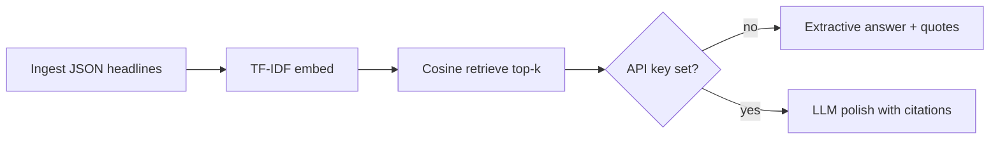

# Day 2 — AI: Stock News RAG (offline)

Tiny retrieval-augmented generation over sample AAPL / MSFT / NVDA headlines. Runs fully offline with TF-IDF + extractive answers; optional Gemini/Groq polish if you set an API key.

## Flow



## Run

```bash
cd day-02-ai-stock-news-rag
python3 -m venv .venv
source .venv/bin/activate   # Windows: .venv\Scripts\activate
pip install -r requirements.txt
pytest -q
python main.py "Why is NVDA mentioned?"
# or: PYTHONPATH=src python -m stock_rag "Microsoft Azure AI"
```

## Env vars (optional)

| Var | Purpose |
|-----|---------|
| `GROQ_API_KEY` | Polish answer via Groq (tried first) |
| `GEMINI_API_KEY` | Polish answer via Gemini if Groq unset |
| `OLLAMA_BASE_URL` | Documented swap path for local embeddings later (not required) |

No keys needed for demo or tests. Secrets stay in env — never commit `.env`.

## Portfolio link

Pairs with the stock-price Databricks / Postgres theme (Day 1 DE): same tickers, now an AI layer that retrieves *why* a name is in the news before you chart prices.
