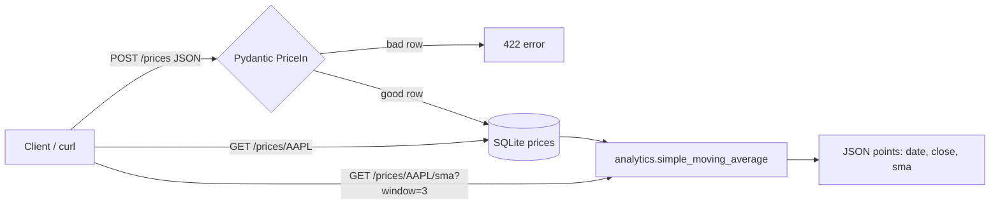

# Day 3 · Python · Stock Price API (FastAPI + Pydantic + pytest)

A tiny REST API that **validates** stock price rows, **stores** them in SQLite, and serves a **moving average**. Same row shape as Day 1's `market.prices`.



## Files
| File | Job |
|------|-----|
| `app/models.py` | Validation rules (ticker letters only, prices > 0, low ≤ open/close ≤ high) |
| `app/db.py` | SQLite table + upsert (one row per ticker per day) |
| `app/analytics.py` | Pure SMA function (no web, no DB) |
| `app/main.py` | FastAPI routes + `get_conn` dependency |
| `tests/` | 12 pytest tests; API tests swap in an in-memory DB |

## Run it
```bash
cd day-03-python-price-api
python -m venv .venv && source .venv/bin/activate
pip install -r requirements.txt
pytest -q                       # 12 passed
uvicorn app.main:app --reload   # open http://127.0.0.1:8000/docs
```

Try a request:
```bash
curl -X POST localhost:8000/prices -H 'Content-Type: application/json' \
  -d '{"ticker":"aapl","trade_date":"2026-10-01","open":100,"high":102,"low":98,"close":101,"volume":5000}'
curl 'localhost:8000/prices/AAPL/sma?window=2'
```

## Try this
Add `GET /prices/{ticker}/returns` that gives the daily % change of `close`. Write the math as a pure function in `analytics.py` first, test it, then add the route.
