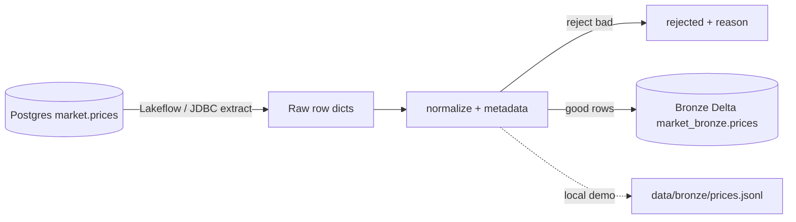

# Day 4 · DE · Lakeflow → Bronze (`market.prices`)

Take Day 1–shaped OHLCV rows, **normalize** them, stamp ingest metadata, and land a **Bronze** Delta table. Local piece runs with pure Python + pytest (no Databricks / Postgres needed).



## Files
| File | Job |
|------|-----|
| `src/bronze/schema.py` | Bronze columns + default `_source_system` |
| `src/bronze/normalize.py` | Uppercase ticker, ISO date, coerce OHLC/vol, reject bad rows |
| `src/bronze/ingest.py` | `land_batch` + optional JSONL write |
| `src/bronze/__main__.py` / `main.py` | CLI over `data/sample_extract.json` |
| `data/sample_extract.json` | ~12 sample rows (clean + dirty) |
| `databricks/01_bronze_ddl.sql` | Delta DDL (`main` catalog = placeholder) |
| `databricks/02_lakeflow_pipeline.py` | DLT / Lakeflow stub (Databricks only) |
| `databricks/STEPS.md` | Numbered workspace steps |
| `tests/` | normalize + ingest pytest |

## Run it
```bash
cd day-04-de-lakeflow-bronze
python -m venv .venv && source .venv/bin/activate
pip install -r requirements.txt
pytest -q
python main.py                    # lands JSONL under data/bronze/
```

Workspace side: follow [`databricks/STEPS.md`](./databricks/STEPS.md). Secrets use env names only: `POSTGRES_JDBC_URL`, `POSTGRES_USER`, `POSTGRES_PASSWORD`.

## Try this
Keep bad rows instead of dropping them: add `_is_valid` (bool) + `_reject_reason` (string|null) on every Bronze record, and land rejects into the same table (or a soft-quarantine twin). Update tests so the dirty sample rows still appear with `_is_valid=false`.
