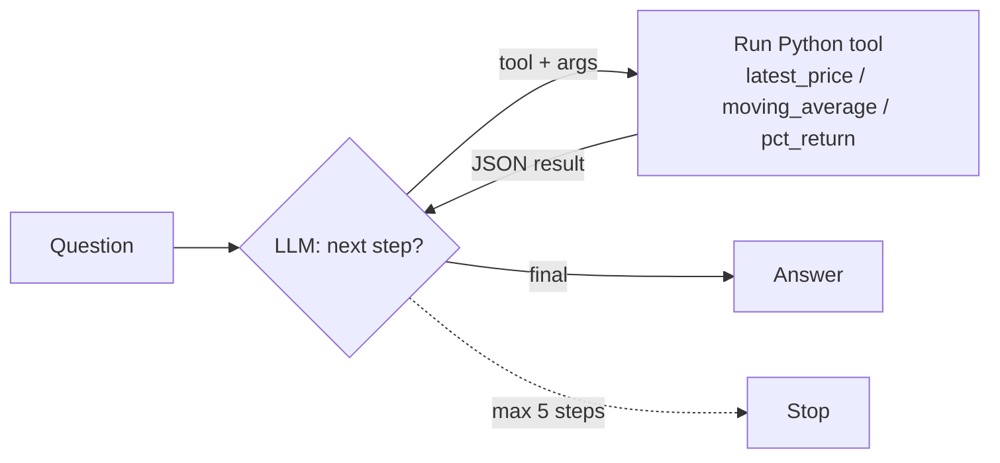

# Day 5 (AI): Stock agent with tools

A tiny **tool-calling LLM agent**. You ask a question; the "LLM" decides which
tool to call; Python runs the tool; the result goes back to the LLM; repeat until
it gives a final answer. Data: 5 days of sample closes for AAPL, MSFT, NVDA.



## LLM backends (pick by env var)
| Env var set | Backend | Cost |
|---|---|---|
| none | `RuleLLM` (keyword router, offline) | free |
| `GROQ_API_KEY` | Groq `llama-3.1-8b-instant` | free tier |
| `OLLAMA_MODEL` | Ollama on localhost | free, local |

Keys are read from env vars only. Never commit `.env`.

## Run
```bash
cd day-05-ai-stock-agent-tools
python3 -m venv .venv && source .venv/bin/activate
pip install -r requirements.txt
pytest -q
PYTHONPATH=src python -m stock_agent "Which did best, AAPL, MSFT or NVDA?"
PYTHONPATH=src python -m stock_agent "3 day average for NVDA"
# with a real model:
GROQ_API_KEY=... PYTHONPATH=src python -m stock_agent "What is AAPL's latest price?"
```

## Files
- `src/stock_agent/tools.py`: the tools + `call_tool` (errors come back as data, not crashes)
- `src/stock_agent/agent.py`: the loop (`run_agent`)
- `src/stock_agent/llm.py`: `RuleLLM`, `OpenAICompatLLM` (Groq/Ollama), `parse_step`
- `tests/`: tools, loop, max-steps guard, JSON parsing with a scripted fake LLM
