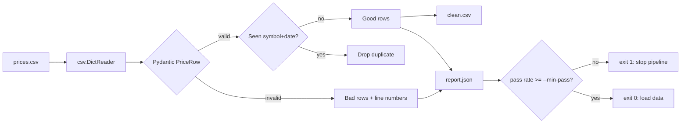

# Day 6 (Python): `pricecheck`, a CSV data-quality CLI

A small installable command-line tool that checks a stock-price CSV **before** it gets loaded
into Postgres `market.prices` or the Bronze layer. Bad rows are reported with line numbers,
duplicates are dropped, and good rows are written to a clean file.



## What it shows
- **Data validation** with Pydantic v2 (field rules + a cross-field rule: `low <= open/close <= high`)
- **CLI** with `argparse` and proper exit codes (0 ok, 1 quality gate failed, 2 missing file)
- **Packaging** with `pyproject.toml` and a `pricecheck` console command
- **Testing** with pytest (parametrized bad rows, `tmp_path`, `capsys`)

## Run it
```bash
cd day-06-python-csv-quality-cli
python -m venv .venv && source .venv/bin/activate
pip install -r requirements.txt
pytest -q                                  # 11 tests

pip install .                              # installs the `pricecheck` command
pricecheck data/prices_sample.csv --out clean.csv --report report.json
pricecheck data/prices_sample.csv --min-pass 90; echo "exit=$?"   # exit=1
```

Sample output:
```
rows=8 good=3 bad=4 dupes=1 pass=37.5%
  line 6: row: Value error, low is greater than high
  line 7: trade_date: Input should be a valid date or datetime, month value is outside expected range of 1-12
  line 8: open: Input should be greater than 0
  line 9: row: Value error, close is outside the low-high range
```

## Files
| File | Job |
|------|-----|
| `src/pricecheck/models.py` | `PriceRow` rules |
| `src/pricecheck/validator.py` | reads CSV, splits good/bad, drops dupes |
| `src/pricecheck/cli.py` | command-line flags and exit codes |
| `tests/` | pytest suite |

## Try this
Add a `--max-volume` flag that marks any row with volume above that number as bad, then add a test for it.
