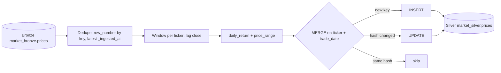

# Day 7 · DE · PySpark/Delta → Silver (`market.prices`)

Turn Bronze (may have duplicates and late corrections) into a clean **Silver** table: one row per `ticker + trade_date`, plus `prev_close`, `daily_return`, `price_range`, written with an idempotent Delta **MERGE**.



## Files
| File | Job |
|------|-----|
| `src/silver/transform.py` | Pure-Python mirror of the Spark logic: `dedupe_latest`, `add_derived`, `merge_upsert` |
| `src/silver/__main__.py` / `main.py` | CLI: Bronze JSONL → Silver JSONL with MERGE stats |
| `data/bronze_sample.jsonl` | 9 Bronze rows over 2 runs (1 exact duplicate, 1 corrected close) |
| `databricks/01_silver_ddl.sql` | Silver Delta DDL (PK, CHECK, CDF, liquid clustering) |
| `databricks/02_silver_merge.py` | PySpark notebook: Window dedupe + lag + `DeltaTable.merge` |
| `databricks/03_checks.sql` | Data-quality checks after the MERGE |
| `databricks/STEPS.md` | Workspace steps to run it yourself |
| `tests/` | pytest for dedupe, returns, MERGE, idempotent re-run |

## Run it
```bash
cd day-07-de-silver-delta
python -m venv .venv && source .venv/bin/activate
pip install -r requirements.txt
pytest -q
python main.py      # 1st run: inserted=7
python main.py      # 2nd run: unchanged=7 (idempotent)
```

Workspace side: follow [`databricks/STEPS.md`](./databricks/STEPS.md).

## Try this
Add a `is_big_move` flag: `true` when `abs(daily_return) > 0.02`. Add it in `add_derived` (Python) and as an `F.when(...)` column in the notebook, then write a test with one 3% day and one 1% day.
