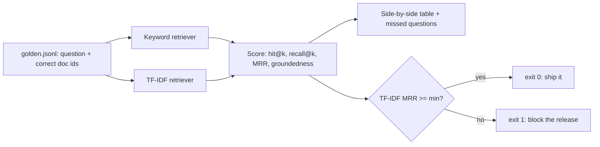

# Day 8 (AI): RAG evals — measure your retriever before you trust it

A small, offline **evaluation harness** for a stock-news RAG. It runs a golden set of
questions through two retrievers (keyword overlap vs TF-IDF), scores them, and fails
the run if quality drops below a threshold — like a unit test for your AI.



## Metrics (all 0 to 1)

| Metric | Question it answers |
|---|---|
| `hit@k` | Did any right doc land in the top k? |
| `recall@k` | What share of the right docs did we find? |
| `MRR` | How high was the first right doc? (1st = 1.0, 2nd = 0.5) |
| `groundedness` | What share of answer sentences are backed by a retrieved source? |

## Run it

```bash
python -m venv .venv && source .venv/bin/activate
pip install -r requirements.txt
pytest -q
PYTHONPATH=src python -m rag_evals --k 3 --min-mrr 0.7 --report report.json
```

Sample output:

```
metric           keyword     tfidf
hit@3              0.875     0.875
recall@3           0.875     0.875
mrr                0.812     0.875
groundedness         1.0       1.0
tfidf missed: Who is returning cash to shareholders?; Which carmaker is struggling?
```

The two misses are on purpose: they use words that aren't in the docs ("cash to
shareholders" vs "buyback"/"dividend"; "carmaker" vs "Tesla"). Lexical search can't
match meaning — that's the case for embeddings, and the eval proves it with a number.

## Files

- `data/news.json` — 12 sample headlines (AAPL, MSFT, NVDA, AMZN, TSLA)
- `data/golden.jsonl` — 16 questions with the doc ids that should come back
- `src/rag_evals/retrievers.py` — keyword and TF-IDF retrievers (stdlib only)
- `src/rag_evals/metrics.py` — hit@k, recall@k, reciprocal rank, groundedness
- `src/rag_evals/runner.py` — runs the golden set and builds the summary
- `src/rag_evals/__main__.py` — CLI with a quality gate (exit code 1 on failure)

No API keys needed. To try an LLM judge later, read a key from an env var such as
`GROQ_API_KEY` or `GEMINI_API_KEY` — never commit keys.
