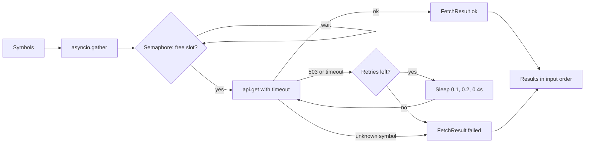

# Day 9 (Python): async quote fetcher with limits, retries, and timeouts

Fetch many stock quotes **at the same time**, without hammering the API, and without one bad symbol breaking the batch.
Stdlib only (`asyncio`), runs offline against a fake API.



## Run

```bash
cd day-09-python-async-fetcher
python -m venv .venv && source .venv/bin/activate
pip install -r requirements.txt
pytest -q
PYTHONPATH=src python -m asyncfetch                # 6 symbols, 3 at a time
PYTHONPATH=src python -m asyncfetch --sequential   # compare the time
```

In the demo NVDA fails twice (fake 503) and then succeeds; TSLA is unknown and fails once with no retry.

## Key ideas

| Piece | Why |
|---|---|
| `asyncio.Semaphore(n)` | Caps calls in flight, so you respect API rate limits |
| `asyncio.wait_for(..., timeout)` | A hung call can't block the batch forever |
| Exponential backoff | Retry 503/429-style errors, giving the server room |
| Permanent errors not retried | A bad symbol won't get better by asking again |
| `gather` + result objects | One failure doesn't cancel the others; order is kept |

To use a real API, replace `FakeQuoteAPI.get` with an `httpx.AsyncClient` call; the fetcher doesn't change.
