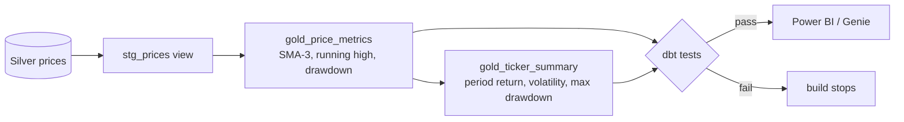

# Day 10 · DE · dbt → Gold (`market.prices`)

Turn Silver into **Gold**: business-ready tables that dashboards and Genie can query directly. Built with **dbt**, tested with dbt data tests + pytest. Runs locally on DuckDB; same models run on Databricks.



## Files
| File | Job |
|------|-----|
| `dbt_market/models/staging/stg_prices.sql` | Reads seed locally, `source('market_silver','prices')` on Databricks |
| `dbt_market/models/gold/gold_price_metrics.sql` | Window functions: SMA-3, running high, drawdown |
| `dbt_market/models/gold/gold_ticker_summary.sql` | One row per ticker: period return, volatility, max drawdown |
| `dbt_market/models/gold/schema.yml` | Generic tests: `unique`, `not_null` |
| `dbt_market/tests/*.sql` | Singular tests: unique key, drawdown never positive |
| `dbt_market/seeds/silver_prices_sample.csv` | 10 Silver rows (2 tickers × 5 days) |
| `run_gold.py` | Runs `dbt build` in Python and prints the summary |
| `databricks/` | Profile example + steps to run on a SQL warehouse |
| `tests/test_gold.py` | pytest checks the Gold numbers by hand |

## Run it
```bash
cd day-10-de-dbt-gold
python -m venv .venv && source .venv/bin/activate
pip install -r requirements.txt
pytest -q             # 5 passed (runs dbt build inside)
python run_gold.py    # PASS=11, prints the summary
```

Workspace side: follow [`databricks/STEPS.md`](./databricks/STEPS.md).

## Try this
Add a `gold_monthly_returns` model: one row per ticker per month with month-end close and monthly return (`date_trunc('month', trade_date)`). Add a `unique` test on `ticker || month`.
