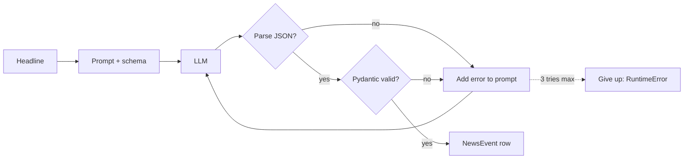

# Day 11 (AI): Structured extraction from stock news

Turn messy headlines into **validated JSON** an analytics table can trust.
The LLM writes JSON, **Pydantic** checks it, and if it's wrong we send the
error back to the LLM and retry (up to 3 times).



Output row: `ticker`, `sentiment` (positive/negative/neutral), `pct_move` (float or null), `event_type`.

## LLM backends (pick by env var)
| Env var set | Backend | Cost |
|---|---|---|
| none | `RuleLLM` (keyword rules, offline) | free |
| `GROQ_API_KEY` | Groq `llama-3.1-8b-instant` | free tier |
| `OLLAMA_MODEL` | Ollama on localhost | free, local |

Keys come from env vars only. Never commit `.env`.

## Run
```bash
cd day-11-ai-news-extractor
python3 -m venv .venv && source .venv/bin/activate
pip install -r requirements.txt
pytest -q
PYTHONPATH=src python -m news_extract                 # uses data/headlines.txt
GROQ_API_KEY=... PYTHONPATH=src python -m news_extract # real model
```

## Files
- `src/news_extract/schema.py`: `NewsEvent` Pydantic model (the contract)
- `src/news_extract/extract.py`: prompt, `parse_json`, `extract` retry loop
- `src/news_extract/llm.py`: `RuleLLM` (offline, can simulate a bad first answer), `OpenAICompatLLM`

## Try this
Add `"guidance"` detection (headlines with "outlook" or "forecast") to `RuleLLM`, plus a test.
