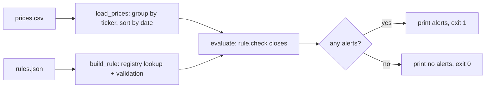

# Day 12 (Python): config-driven price alerts

A small CLI that reads stock closes from a CSV, runs alert rules from a JSON file, and prints alerts. Stdlib only.



## Rule types
| type | fields | fires when |
|------|--------|------------|
| `above` | `price` | last close > price |
| `below` | `price` | last close < price |
| `pct_change` | `pct` | one-day move is at least pct% |
| `sma_cross` | `window` | close crosses its N-day SMA today |

New rule = one `@register("name")` dataclass with a `check()` method.

## Run
```bash
pip install -r requirements.txt
python -m pytest -q
PYTHONPATH=src python -m pricealerts --prices sample/prices.csv --rules sample/rules.json -v
PYTHONPATH=src python -m pricealerts --prices sample/prices.csv --rules sample/rules.json --json
```
Exit codes: 0 no alerts, 1 alerts fired, 2 bad config. That makes it easy to call from cron or n8n.

## Concepts
Registry/decorator pattern, frozen dataclasses, custom exceptions, `logging`, `argparse`, pytest `parametrize`, `tmp_path`, `caplog`, `capsys`.
