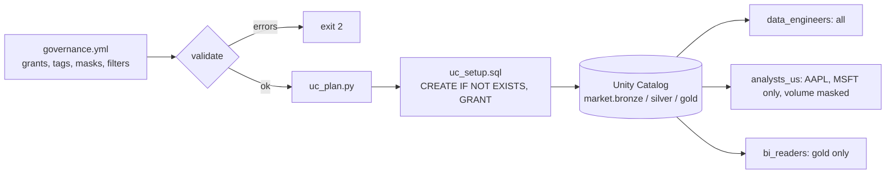

# Day 13 · DE · Unity Catalog governance as code (`market`)

Lock down Bronze, Silver, and Gold with **Unity Catalog**: grants, tags, a column mask, and a row filter. You write the rules once in `governance.yml`; `uc_plan.py` turns them into idempotent SQL you run on Databricks. A small local simulator answers "can this group see this row?" so pytest can check the policy without a workspace.



## Files
| File | Job |
|------|-----|
| `governance.yml` | The policy: catalog, schemas, group grants, tags, mask, row filter |
| `uc_plan.py` | Validates the YAML, emits SQL, and has a `can_see()` access simulator |
| `databricks/uc_setup.sql` | Generated SQL, ready to paste into a SQL editor |
| `databricks/STEPS.md` | What to run in your workspace |
| `tests/test_uc_plan.py` | 12 tests: SQL order, least privilege, row filter, bad privilege caught |

## Run it
```bash
cd day-13-de-unity-catalog
python -m venv .venv && source .venv/bin/activate
pip install -r requirements.txt
pytest -q                                   # 12 passed
python uc_plan.py -o databricks/uc_setup.sql
```

## Try this
Add a `pii_viewers` group that can see `volume` unmasked on Silver. Change `exempt_group` to a list, update the mask SQL to `is_account_group_member('a') OR is_account_group_member('b')`, and add a test.
