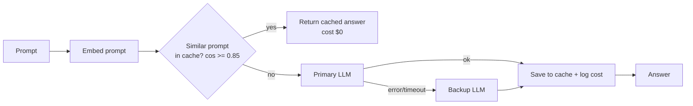

# Day 14 (AI): LLM gateway with semantic cache + fallback

Every AI app calls an LLM. A **gateway** sits in front of it to cut cost and survive outages.



## What it does
- `embed.py` – tiny offline embedding (hashed words + trigrams), cosine similarity.
- `cache.py` – semantic cache with threshold, TTL expiry, and max-size eviction.
- `providers.py` – offline fakes (`EchoProvider`, `FlakyProvider`) plus optional `GroqProvider` (`GROQ_API_KEY`) and `OllamaProvider`.
- `gateway.py` – cache first, then providers in order; tracks hit rate, fallbacks, errors, estimated cost.

## Run
```bash
python -m venv .venv && source .venv/bin/activate
pip install -r requirements.txt
pytest -q                 # 9 tests, fully offline
python src/demo.py        # offline demo
# optional real model: pip install requests; export GROQ_API_KEY=...; USE_GROQ=1 python src/demo.py
```

## Try this
Add a `bypass_cache=True` flag to `Gateway.ask` for prompts that must be fresh (e.g. "latest price"), plus a test.
