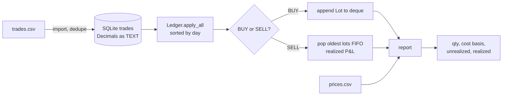

# Day 15 · Python · FIFO Portfolio Ledger

Import trades from a CSV into SQLite, then get **cost basis, realized P&L and unrealized P&L** per ticker using FIFO (oldest shares sold first).



## What it shows
- `Decimal` money (no `0.1 + 0.2` float drift), rounded to cents with `ROUND_HALF_UP`
- `@dataclass(frozen=True)` with validation in `__post_init__`
- `collections.deque` for FIFO lots
- A `@contextmanager` that commits, rolls back on error, and always closes the SQLite connection
- Idempotent import (`UNIQUE` + `INSERT OR IGNORE`)
- pytest fixtures, `parametrize`, `tmp_path`, `capsys`

## Run it
```bash
cd day-15-python-portfolio-ledger
python3 -m venv .venv && . .venv/bin/activate
pip install -r requirements.txt
pytest -q                                   # 11 tests
PYTHONPATH=src python -m ledger.cli import sample/trades.csv
PYTHONPATH=src python -m ledger.cli report --prices sample/prices.csv
```

Expected:
```
ticker  qty  cost_basis  market_value  unrealized  realized
AAPL      5      600.50        625.00       24.50    347.50
MSFT      5     2000.00       2050.00       50.00      0.00
```
