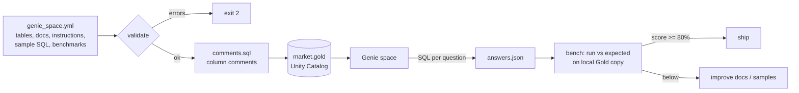

# Day 16 · DE · Genie space as code (`market.gold`)

Let business users ask plain-English questions about the Gold tables with **Databricks AI/BI Genie**. The space (tables, column comments, instructions, trusted example SQL, benchmark questions) lives in `genie_space.yml`, so it gets reviewed like code. `genie_check.py` validates it, generates the column comments Genie reads, and scores Genie's answers by comparing **result sets**, not SQL text.



## Files
| File | Job |
|------|-----|
| `genie_space.yml` | The Genie space definition |
| `genie_check.py` | `validate`, `comments`, `bench` commands |
| `data/silver_prices_sample.csv` | Same Silver sample as Day 10; rebuilt into Gold in SQLite |
| `answers.example.json` | Example Genie answers (different SQL, same results) |
| `databricks/comments.sql` | Generated `ALTER COLUMN ... COMMENT` statements |
| `databricks/STEPS.md` | What to do in your workspace |
| `tests/test_genie_check.py` | 13 tests: safety, validation, Gold math, benchmark scoring, CLI exit codes |

## Run it
```bash
cd day-16-de-genie-space
python -m venv .venv && source .venv/bin/activate
pip install -r requirements.txt
pytest -q                                            # 13 passed
python genie_check.py validate
python genie_check.py comments -o databricks/comments.sql
python genie_check.py bench --answers answers.example.json   # 3/3 = 100%
```

## Try this
Add a benchmark "Which day did MSFT close highest?" with its `expected_sql`. Ask Genie the same question, paste its SQL into `answers.json`, and run `bench`. If it fails, add an instruction or a sample query until it passes.
