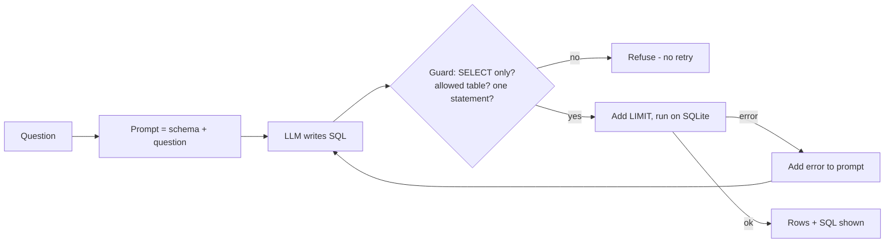

# Day 17 (AI): Guarded text-to-SQL agent

Ask a question in plain English, the LLM writes SQL, a **guard** checks it, and if SQLite errors the agent **feeds the error back** so the model fixes its own query.



## What it does
- `db.py` - in-memory SQLite `prices` table (ticker, trade_date, close, volume).
- `guard.py` - blocks writes/DDL, multiple statements, and tables outside the allowlist; adds `LIMIT 100`.
- `llm.py` - offline `RuleLLM` (makes one deliberate typo to exercise retries), plus optional `OllamaLLM` and `GroqLLM` (`GROQ_API_KEY` env var only).
- `agent.py` - generate, guard, run, and retry up to 3 times with the error message.

## Run
```bash
python -m venv .venv && source .venv/bin/activate
pip install -r requirements.txt
pytest -q                          # 14 tests, fully offline
PYTHONPATH=src python src/demo.py  # offline demo
# real model: pip install requests; then USE_OLLAMA=1 or (export GROQ_API_KEY=...; USE_GROQ=1)
```

## Try this
Add a `cost guard`: before running, call `EXPLAIN QUERY PLAN` and refuse queries that do a full `SCAN` without a `WHERE`, plus a test.
