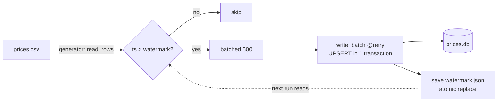

# Day 18 (Python): Incremental CSV loader

Loads only **new** price rows into SQLite, using a saved watermark. Shows generators, decorators (`@retry`, `@timed`), batching, upserts, and atomic checkpoints.



## Run

```bash
cd day-18-python-incremental-loader
pip install -r requirements.txt
PYTHONPATH=src python3 -m incload.loader sample/prices.csv   # loads 4 rows
PYTHONPATH=src python3 -m incload.loader sample/prices.csv   # loads 0 (already done)
pytest -q
```

## Key ideas
- `read_rows` is a generator, so a 10 GB file uses little memory.
- `batched` uses `islice` to chunk lazily.
- `@retry` retries only `sqlite3.OperationalError` (e.g., "database is locked") with backoff.
- Watermark is saved after each committed batch, so a crash resumes where it stopped.
- `ON CONFLICT ... DO UPDATE` makes reruns safe (idempotent).
