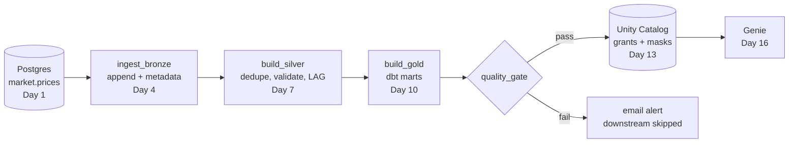

# Day 19 · DE · Capstone: the whole stock pipeline as one job

This ties Days 1, 4, 7, 10, 13 and 16 together. One task list runs the full pipeline locally (SQLite) **and** generates the Databricks job (`bundle/databricks.yml`), so local and production never drift apart.



## How it works
- `src/dag.py` sorts tasks by dependency (Kahn's algorithm), retries flaky ones, and **skips everything downstream of a failure**.
- `src/pipeline.py` has the 5 tasks. Bronze only appends; Silver keeps the latest row per `(ticker, trade_date)` and drops bad prices; Gold summarizes per ticker.
- `quality_gate` checks Silver is non-empty, unique, positive, and that Gold covers every ticker.
- `src/bundle.py` turns the same task list into a Databricks Asset Bundle job: schedule 6:30 PM MT weekdays, retries, failure email.

## Run it
```bash
cd day-19-de-pipeline-capstone
python -m venv .venv && source .venv/bin/activate
pip install -r requirements.txt
pytest -q                      # 12 passed
python src/main.py run         # all 5 tasks SUCCESS, 1 row quarantined
python src/main.py bundle      # regenerates bundle/databricks.yml
```

## On Databricks (you run this)
1. Put the Day 4, 7, 10 and Day 1 code into notebooks named like the `notebook_path` values in `bundle/databricks.yml` (folder `notebooks/` next to `bundle/`).
2. Install the CLI and log in: `databricks auth login --host <your-workspace-url>`.
3. From `bundle/`: `databricks bundle validate`, then `databricks bundle deploy -t dev --var alert_email=<you@example.com>`.
4. `databricks bundle run stock_pipeline` and watch the DAG in **Workflows → Jobs**.
5. Break it on purpose (insert a duplicate into Silver) and confirm `quality_gate` fails and you get the email.

## Try this
Add a `refresh_genie` task that depends on `quality_gate` and only prints "Genie refreshed". Rerun `python src/main.py bundle`, then make `test_committed_bundle_is_up_to_date` pass again.
