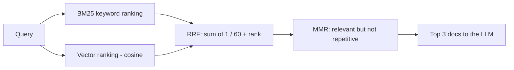

# Day 20 (AI): Hybrid search (BM25 + vectors, RRF, MMR)

Keyword search finds exact words like `NVDA`. Vector search finds meaning like "Nvidia shares rise". **Hybrid** runs both, fuses the ranks with **RRF**, then uses **MMR** so the top results aren't near-duplicates. This is the retriever that sits in front of a RAG app.



## What it does
- `bm25.py` - BM25 scoring from scratch (term frequency, IDF, length normalization).
- `vectors.py` - offline hashed embeddings with a tiny synonym map (`NVDA` maps to `nvidia`); optional real embeddings from local Ollama.
- `fusion.py` - `rrf()` merges rankings by rank, so BM25 and cosine scores never need rescaling; `mmr()` trades relevance against redundancy with `lam`.
- `search.py` - `HybridSearch` wires it together; the embedder is pluggable.

## Run
```bash
python -m venv .venv && source .venv/bin/activate
pip install -r requirements.txt
pytest -q                          # 10 tests, fully offline
PYTHONPATH=src python src/demo.py  # compare BM25 vs Vector vs Hybrid
# real embeddings: pip install requests; ollama pull nomic-embed-text; USE_OLLAMA=1 PYTHONPATH=src python src/demo.py
```

## Try this
Add a `weights` option to `rrf()` (for example keyword 0.3, vector 0.7) and a test showing the weighting flips the top result for one query.
