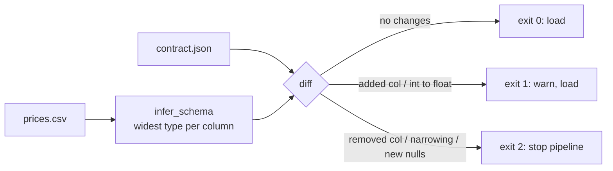

# Day 21 (Python): Schema drift detector

Checks a CSV against a **data contract** before it loads. Infers each column's type, diffs it with the contract, and returns an exit code a pipeline can act on.



## Run

```bash
cd day-21-python-schema-drift
pip install -r requirements.txt
PYTHONPATH=src python3 -m drift.cli sample/prices_ok.csv sample/contract.json        # exit 0
PYTHONPATH=src python3 -m drift.cli sample/prices_drifted.csv sample/contract.json   # exit 2
PYTHONPATH=src python3 -m drift.cli sample/prices_drifted.csv sample/contract.json --json
pytest -q
```

## Key ideas
- Type ladder: `int -> float -> date -> timestamp -> string`; `merge()` picks a type that fits every value.
- `int -> float` and `date -> timestamp` are safe widening (warn). Anything else that changes type breaks.
- A removed column or nulls in a NOT NULL column break downstream, so they are `BREAK`.
- Exit codes (0/1/2) let Airflow, Databricks Workflows, or CI decide: continue, alert, or stop.
- Same idea as Delta Lake schema enforcement and dbt model contracts, in plain Python.
