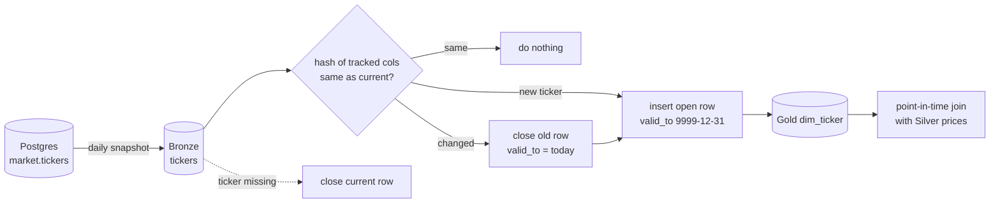

# Day 22 · DE · SCD Type 2 ticker dimension

Company names and sectors change (Facebook became Meta). **SCD Type 2** keeps every version with a date range, so old prices still join to the name that was true *on that day*.



## How it works
- `row_hash` hashes only `company_name, sector, exchange`, so case/space noise never makes a new version.
- Changed ticker: old row gets `valid_to = as_of, is_current = false`; a new row opens with a new `ticker_sk`.
- Ticker gone from the source: its current row is closed (soft delete).
- Rerunning the same snapshot changes nothing (idempotent).
- `check_dim` = data tests: one current row per ticker, no overlapping ranges.

## Files
| File | Job |
|------|-----|
| `src/scd2/core.py` | `scd2_merge`, `lookup_as_of`, `check_dim` |
| `src/scd2/__main__.py` | demo over 3 snapshots in `data/` |
| `databricks/00_postgres_source.sql` | `market.tickers` source table in local Postgres |
| `databricks/01_dim_ddl.sql` | Delta `dim_ticker` |
| `databricks/02_scd2_merge.sql` | SCD2 in one Delta `MERGE` |
| `databricks/03_point_in_time_join.sql` | prices joined to the right version |
| `databricks/04_checks.sql` | must-return-0-rows checks |
| `dbt/snapshots/snap_tickers.sql` | same thing the dbt way (`dbt snapshot`) |

## Run it
```bash
cd day-22-de-scd2-ticker-dim
python -m venv .venv && source .venv/bin/activate
pip install -r requirements.txt
pytest -q                    # 10 passed
cd src && python -m scd2     # prints the dimension + META lookup on 2026-10-02
```

## On Databricks (you run this)
1. In local Postgres run `databricks/00_postgres_source.sql`.
2. Ingest `market.tickers` to `market_bronze.tickers` the same way as Day 4 (Lakeflow / JDBC).
3. In a SQL editor run `01_dim_ddl.sql`, then `02_scd2_merge.sql`.
4. In Postgres run the commented `UPDATE` for META, re-ingest, rerun `02`. You should see 2 META rows.
5. Run `03` and `04` (both checks return 0 rows). Optional: add the dbt snapshot to the Day 10 project and run `dbt snapshot`.

## Try this
Make `exchange` a **Type 1** column: when only the exchange changes, overwrite it on the current row instead of opening a new version. Add a test proving the row count stays the same.
