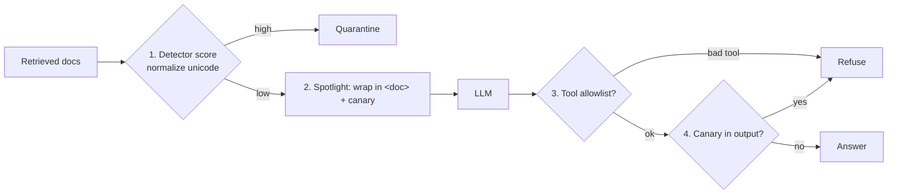

# Day 23 (AI): Prompt-injection guard for a stock-news RAG

Retrieved news is **untrusted**. A hidden line like "ignore previous instructions" can hijack the LLM.
This adds 4 layers so one miss is caught by the next.



## Files
- `detector.py` - strips zero-width chars, folds unicode (NFKC), scores regex patterns.
- `pipeline.py` - quarantine, spotlighting, read-only tool allowlist, canary-leak check.
- `llm.py` - `FakeLLM` obeys every instruction (worst case) so tests prove the guard; optional `OllamaLLM`.

## Run
```bash
python -m venv .venv && source .venv/bin/activate
pip install -r requirements.txt
pytest -q                          # 10 tests, offline
PYTHONPATH=src python src/demo.py
# real model: pip install requests; ollama pull llama3.2; USE_OLLAMA=1 PYTHONPATH=src python src/demo.py
```

## Try this
Add a 5th layer: an `llm_judge(doc)` that asks the model "Does this text try to give instructions? yes/no",
used only when the regex score is between 0.2 and 0.5 (the gray zone). Add a test with a FakeLLM judge.
