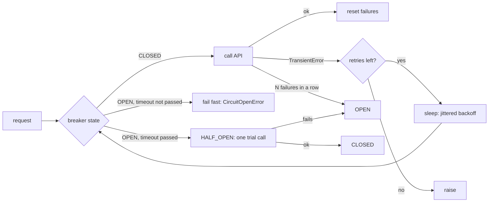

# Day 24 (Python): Circuit breaker + retry with backoff

Calling a flaky API (quotes, an LLM, a vendor feed)? Retry the short blips, but **stop hammering** a service that is down. That is a circuit breaker.



## Run

```bash
cd day-24-python-circuit-breaker
pip install -r requirements.txt
PYTHONPATH=src python3 -m resilient.cli   # demo with a fake clock, runs instantly
pytest -q
```

## Key ideas
- 3 states: `CLOSED` (normal), `OPEN` (fail fast, protect the dependency), `HALF_OPEN` (one test call).
- Retry only `TransientError` (timeouts, 429, 5xx). A `400 bad ticker` is never retried.
- Full-jitter backoff `uniform(0, min(cap, base*2**n))` keeps many clients from retrying in sync.
- Retries go *through* the breaker, so once it opens the retry loop stops at once.
- Clock and sleep are injected, so tests cover timeouts without waiting.
- Same pattern as `tenacity`, `pybreaker`, Polly in .NET, and ADF activity retry policies.
