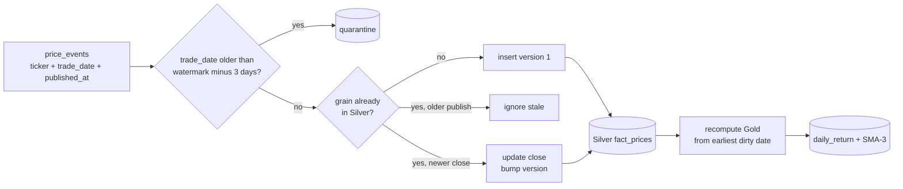

# Day 25 · DE · Late-arriving price facts

Vendors restate closes. A row for **October 3** can show up on **October 6**. You upsert Silver on `(ticker, trade_date)` if the new `published_at` is newer, then rebuild Gold from that day forward — because returns and SMA both read the corrected close.



## How it works
- Grain is `(ticker, trade_date)`. Same grain + newer `published_at` + different close = correction.
- `watermark` is the max `trade_date` already stored. Events older than `watermark - 3 days` go to quarantine, not a silent rewrite.
- Replaying the same batch changes nothing (idempotent). An older publish is ignored (stale).
- Gold from the earliest dirty date is replaced. Later days stay correct because their return/SMA see the new close.
- `check_facts` flags duplicate grains and corrections that forgot to bump `version`.

## Files
| File | Job |
|------|-----|
| `src/late_facts/core.py` | `apply_events`, `compute_gold`, `check_facts` |
| `src/late_facts/__main__.py` | demo over the 3 batches in `data/` |
| `databricks/00_postgres_source.sql` | `market.price_events` in local Postgres |
| `databricks/01_silver_ddl.sql` | Delta Silver + quarantine + Gold |
| `databricks/02_merge_corrections.sql` | MERGE + quarantine insert |
| `databricks/03_recompute_gold.sql` | delete/insert Gold from `gold_from` |
| `databricks/04_checks.sql` | must-return-0-rows checks |
| `dbt/models/silver/fact_prices.sql` | incremental merge with an N-day lookback |
| `dbt/models/gold/fact_price_metrics.sql` | return + SMA-3 |

## Run it
```bash
cd day-25-de-late-arriving-facts
python -m venv .venv && source .venv/bin/activate
pip install -r requirements.txt
pytest -q
cd src && python -m late_facts
```

The demo prints the Oct 3 AAPL correction to `177.20` (version 2) and quarantines the Sep 20 row.

## On Databricks (you run this)
1. In local Postgres run `databricks/00_postgres_source.sql`.
2. Ingest `market.price_events` to `main.market_bronze.price_events` the same way as Day 4 (Lakeflow / JDBC).
3. In a SQL editor run `01_silver_ddl.sql`, then `02_merge_corrections.sql`, then `03_recompute_gold.sql`.
4. Check Silver: AAPL on `2026-10-03` should be `177.20`, `version = 2`, `is_correction = true`.
5. Check quarantine: AAPL `2026-09-20` is there. Run `04_checks.sql` (the first two queries return 0 rows).

## Try this
Call `apply_events` with `allowed_lateness_days=0` on the Oct 6 batch. The AAPL Oct 3 correction should go to quarantine and Silver should keep `178.50`.
