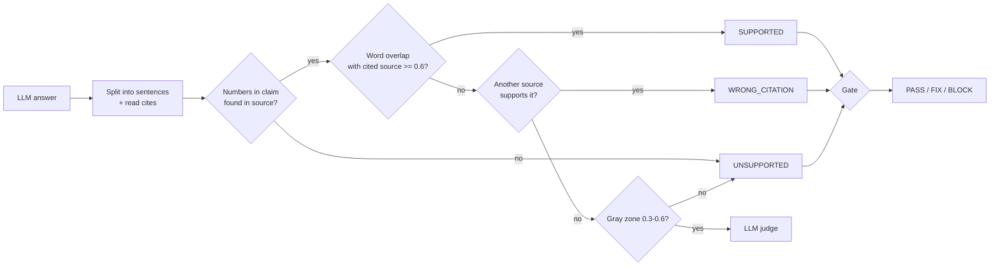

# Day 26 (AI): Citation checker for RAG answers

An LLM can cite `[1]` and still make things up. This checks **every sentence** of the answer
against the source it cites, before the user sees it.



## Files
- `grounding.py` - split claims, number check, overlap score, verdicts, groundedness %, gate, citation repair.
- `llm.py` - LLM judge only for gray-zone claims (`FakeJudge` for tests, optional `OllamaJudge`).
- `demo.py` - 4 sentences: one good, one wrong cite, one wrong number, one with no cite.

## Run
```bash
python -m venv .venv && source .venv/bin/activate
pip install -r requirements.txt
pytest -q                          # 11 tests, offline
PYTHONPATH=src python src/demo.py
# real judge: pip install requests; ollama pull llama3.2; USE_OLLAMA=1 PYTHONPATH=src python src/demo.py
```

## Try this
Handle a claim that cites two sources (`[1][2]`) where each source supports half the claim.
Score the claim against the *joined* text of all its cited sources, and add a test.
