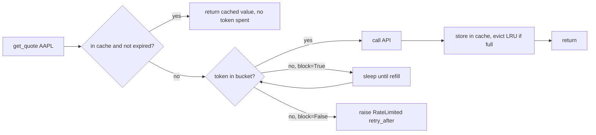

# Day 27 (Python): Token-bucket rate limiter + TTL/LRU cache

A quotes API allows only N calls per second. Serve repeat lookups from a cache, and only spend rate-limit tokens on cache misses.



## Run

```bash
cd day-27-python-rate-limit-cache
pip install -r requirements.txt
PYTHONPATH=src python3 -m throttle.cli   # fake clock, runs instantly
pytest -q
```

## Key ideas
- Token bucket: refill `rate` tokens/sec up to `capacity`. Capacity = allowed burst.
- Wait time when empty is `(cost - tokens) / rate`, also returned as `retry_after`.
- `TTLCache` = `OrderedDict` for LRU order + an expiry time per entry.
- Cache check happens *before* the limiter, so hits are free and instant.
- Clock and sleep are injected, so tests cover time without waiting.
- Same ideas as `functools.lru_cache`, `cachetools.TTLCache`, API gateway throttling, and Redis caching.
