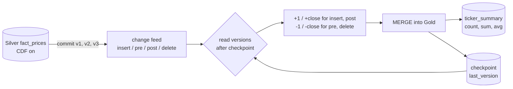

# Day 28 · DE · Change Data Feed → incremental Gold

Gold used to rescan all of Silver. With **Delta Change Data Feed (CDF)**, Silver logs every row change per version. Gold reads only the changes after its last **checkpoint version** and adds or subtracts them.



## How it works
- Every commit to Silver gets a version. CDF logs each changed row with `_change_type` and `_commit_version`.
- An update logs two rows: `update_preimage` (old value) and `update_postimage` (new value).
- Gold adds inserts/postimages and subtracts preimages/deletes. No full scan.
- The checkpoint stores the last version used, so a rerun reads 0 changes (idempotent).
- A test runs 40 random commits and proves incremental Gold == full recompute.

## Files
| File | Job |
|------|-----|
| `src/cdf_gold/core.py` | `DeltaTable` (fake CDF), `CdfConsumer`, `full_recompute` |
| `src/cdf_gold/__main__.py` | demo: load, correct, delete, rerun |
| `databricks/01_enable_cdf.sql` | turn on CDF, create Gold + checkpoint, first full load |
| `databricks/02_make_changes.sql` | one update + one delete, then view `table_changes` |
| `databricks/03_incremental_gold.sql` | fold changes into Gold with MERGE, move checkpoint |
| `databricks/04_check.sql` | must return 0 rows |
| `databricks/05_streaming_option.py` | same thing with `readChangeFeed` streaming |

## Run it
```bash
cd day-28-de-cdf-incremental-gold
python -m venv .venv && source .venv/bin/activate
pip install -r requirements.txt
pytest -q
cd src && python -m cdf_gold
```

## On Databricks (you run this)
1. Run `01_enable_cdf.sql` (uses Silver `main.market_silver.fact_prices` from earlier days).
2. Run `02_make_changes.sql`. You should see `update_preimage`, `update_postimage`, and `delete` rows.
3. Run `03_incremental_gold.sql`. Run it again: nothing changes.
4. Run `04_check.sql`. It must return 0 rows.

## Try this
Add `max_close` to Gold. Why does a delete make it hard to do incrementally? (Hint: subtracting doesn't work for max.)
