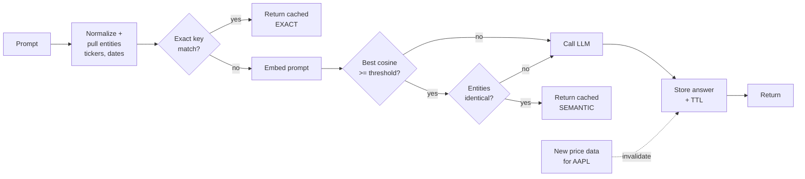

# Day 29 (AI): Semantic cache for LLM calls

Same question asked 100 ways = 100 paid LLM calls. A semantic cache answers repeats and
paraphrases from memory, but **never** serves an AAPL answer to an MSFT question.



## Files
- `cache.py` - normalize, entity guard, exact + semantic lookup, TTL, LFU eviction, invalidate-by-ticker, hit-rate stats.
- `embed.py` - `HashEmbedder` (offline, for tests) and `OllamaEmbedder` (`nomic-embed-text`).
- `llm.py` - `FakeLLM` that counts calls, optional `OllamaLLM`.
- `demo.py` - 6 questions, prints which were served from cache.

## Run
```bash
python3 -m venv .venv && source .venv/bin/activate
pip install -r requirements.txt
pytest -q                           # 11 tests, offline
PYTHONPATH=src python src/demo.py   # LLM calls: 4/6
# real: pip install requests; ollama pull nomic-embed-text llama3.2; USE_OLLAMA=1 PYTHONPATH=src python src/demo.py
```

## Try this
Make the TTL depend on the question: prices from today expire in 5 minutes, questions about
old dates (before today) never expire. Add a test with the fake clock.
