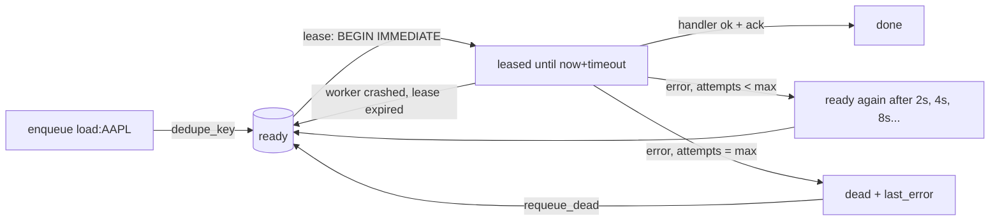

# Day 30 (Python): Durable job queue on SQLite

Workers load daily prices per ticker. Jobs survive crashes, retry with backoff, and land in a dead-letter state when they keep failing. Standard library only.



## Run

```bash
cd day-30-python-sqlite-job-queue
pip install -r requirements.txt
PYTHONPATH=src python3 -m jobq.cli   # fake clock, runs instantly
pytest -q
```

## Key ideas
- **Lease, don't delete**: a claimed job is hidden for `visibility_timeout`; if the worker dies, it comes back (like SQS).
- **`BEGIN IMMEDIATE`** takes the write lock, so two workers can't claim the same row.
- **Lease token**: a late worker's `ack` is rejected after someone else took over.
- **Backoff** = `base * 2**(attempts-1)`; after `max_attempts` the job is `dead`.
- **`dedupe_key` UNIQUE + `INSERT OR IGNORE`** makes enqueue idempotent.
- At-least-once delivery, so handlers should be idempotent (e.g. MERGE, not INSERT).
