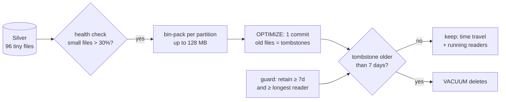

# Day 31 · DE · Delta table maintenance: OPTIMIZE + safe VACUUM

Streaming and MERGE jobs leave **thousands of tiny files** in Silver. Queries slow down.
**OPTIMIZE** packs small files into ~128 MB files. **VACUUM** deletes old, unused files, but only after a safe retention window.



## How it works
- `health()` counts files and the share of small ones (< 25% of target).
- `plan_optimize()` packs small files per partition (first-fit decreasing). Never mixes partitions. Skips big files and 1-file bins.
- `apply_optimize()` writes new files in **one commit**. Old files are only marked removed (tombstones).
- `plan_vacuum()` deletes tombstones older than the retention. Blocks retention < 7 days or < the longest running reader.
- A random test proves data bytes never change across OPTIMIZE + VACUUM.

## Files
| File | Job |
|------|-----|
| `src/delta_maint/core.py` | fake Delta log, health, bin-packing, vacuum guard, SQL render |
| `src/delta_maint/__main__.py` | demo: 96 tiny files → 4 files → vacuum |
| `databricks/01_inspect.sql` | file count, avg size, history |
| `databricks/02_optimize.sql` | compact recent dates |
| `databricks/03_liquid_clustering.sql` | `CLUSTER BY` instead of ZORDER |
| `databricks/04_vacuum.sql` | dry run, then vacuum |
| `databricks/05_predictive_optimization.sql` | let Databricks do it automatically |

## Run it
```bash
cd day-31-de-delta-maintenance
python -m venv .venv && source .venv/bin/activate
pip install -r requirements.txt
pytest -q
cd src && python -m delta_maint
```

## On Databricks (you run this)
1. Run `01_inspect.sql`. Note `numFiles` and `avg_file_mb`.
2. Run `02_optimize.sql`. Run `01` again: fewer, bigger files.
3. Run `04_vacuum.sql` with `DRY RUN` first.
4. Optional: try `03` on a copy, and `05` to automate it.

## Try this
Add `max_files_per_run` to `plan_optimize()` so one run rewrites at most N files (keeps the job cheap). Write a test for it.
