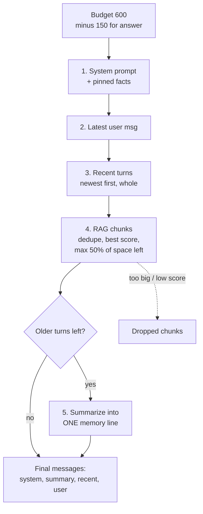

# Day 32 (AI): Context-window packer

An LLM has a fixed token budget. A long chat + RAG chunks + memory will overflow it.
This packer decides **what goes in, in what order, and what gets squashed** — and leaves room for the answer.



## Files
- `tokens.py` - cheap counter (~4 chars per token).
- `packer.py` - `pack()` with priority order, chunk dedupe + cap, summary of old turns, `BudgetError`.
- `summarizer.py` - `FakeSummarizer` (offline, counts calls) and `OllamaSummarizer` (`llama3.2`).
- `demo.py` - 20-turn AAPL chat + 4 news chunks squeezed into 600 tokens.

## Run
```bash
python3 -m venv .venv && source .venv/bin/activate
pip install -r requirements.txt
pytest -q                            # 10 tests, offline
PYTHONPATH=src python src/demo.py    # used 268/600 tokens, summarized 16 old turns, dropped 1 chunk
# real summaries: pip install requests; ollama pull llama3.2; USE_OLLAMA=1 PYTHONPATH=src python src/demo.py
```

## Try this
Cache the summary: if the older turns did not change since last call, reuse the old summary
instead of calling the summarizer again. Add a test that `summarizer.calls` stays at 1 across two packs.
