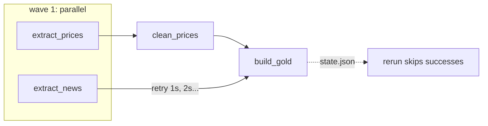

# Day 33 (Python): Mini DAG runner (Airflow in ~150 lines)

Runs a stock pipeline as a DAG: dependency order, parallel waves, retries with backoff, skip-downstream on failure, results passed to children, and resume from a JSON state file. Standard library only.



## Run

```bash
cd day-33-python-mini-dag-runner
pip install -r requirements.txt
PYTHONPATH=src python3 -m dagrun.cli
pytest -q
```

## Key ideas
- **Kahn's algorithm** groups tasks into waves; each wave runs on a thread pool.
- **Cycle check**: if not every task is placed, DFS prints the cycle path (`a -> b -> c -> a`).
- **Retries**: `retry_delay * 2**(attempt-1)`; the sleep is injectable so tests run instantly.
- **Failure isolation**: a failed task skips only its descendants; other branches still run.
- **Resume**: successes are saved after every wave; a rerun only does failed/skipped work (like Airflow "clear failed").
