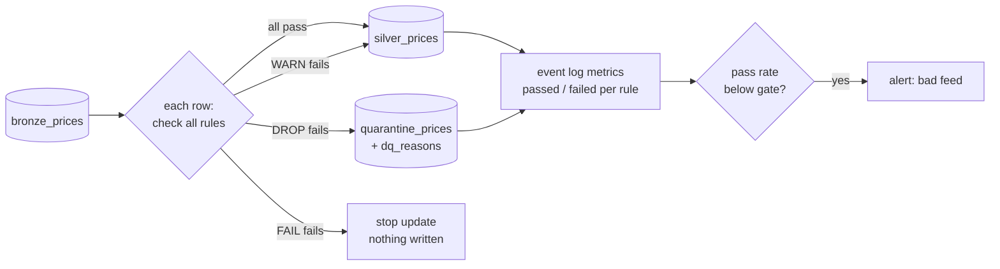

# Day 34 · DE · Data quality expectations + quarantine (Lakeflow)

Bad rows from Bronze (blank ticker, negative price, high < low) must not reach Silver.
Lakeflow **expectations** check every row. Each rule has an action: **warn**, **drop**, or **fail**.
We also keep dropped rows in a **quarantine** table with the reasons, so nothing is lost.



## How it works
- `Expectation` = name + check + action + the SQL text for Databricks.
- `run()` checks every rule on every row and counts passed/failed per rule.
- WARN keeps the row. DROP sends it to quarantine with **all** failed rule names. FAIL raises and writes nothing.
- A NULL value is a violation, not a crash (same as SQL: NULL is not true).
- `gate()` stops a batch when the pass rate is too low (upstream feed is broken).
- `render_sql()` turns the same rules into a Lakeflow `CONSTRAINT ... EXPECT` block.

## Files
| File | Job |
|------|-----|
| `src/dq_expect/core.py` | rules, warn/drop/fail engine, quarantine, gate, SQL render |
| `src/dq_expect/__main__.py` | demo: 4 rows → 2 clean, 2 quarantined |
| `databricks/01_silver_with_expectations.sql` | Silver with constraints |
| `databricks/02_quarantine.sql` | bad rows + `dq_reasons` array |
| `databricks/03_dq_metrics.sql` | pass/fail per rule from the event log |
| `databricks/04_python_expectations.py` | same rules with `@dlt.expect_*` |

## Run it
```bash
cd day-34-de-expectations-quarantine
python -m venv .venv && source .venv/bin/activate
pip install -r requirements.txt
pytest -q
PYTHONPATH=src python -m dq_expect
```

## On Databricks (do it yourself)
1. Open your stock pipeline (from Day 4/7). Add `01_silver_with_expectations.sql` and `02_quarantine.sql` as source files (or `04_python_expectations.py`).
2. Insert a bad row into Postgres `market.prices` (e.g. `close = -1`), then run the pipeline.
3. Click `silver_prices` in the pipeline graph → **Data quality** tab: see `positive_close` failed = 1.
4. Query `quarantine_prices`: the row is there with `dq_reasons = [positive_close]`.
5. Run `03_dq_metrics.sql` (change `main.market` to your catalog.schema).
6. Try it: insert a row with `trade_date = NULL`. The update **fails**. Delete it and rerun.
