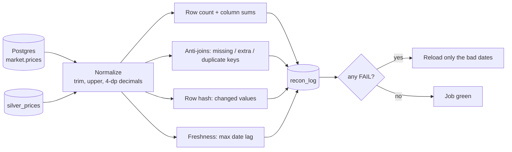

# Day 37 · DE · Source-to-target reconciliation (Postgres → Silver)

Proof that Silver matches the on-prem source `market.prices`. Banks and asset managers ask for this evidence on every load.



## How it works
- Both sides are **normalized** first, so `' aapl'` vs `'AAPL'` and `228.1` vs `228.1000` don't cause false alarms.
- **Counts + sums** are cheap first checks. But counts can match while data is wrong (one row lost, one doubled).
- **Anti-joins** on the key `(ticker, trade_date)` find missing, extra and duplicate rows.
- **Row hash** (md5 of the values) finds rows whose values changed in flight.
- `reload_dates()` returns the smallest set of dates to re-ingest, instead of a full reload.

## Files
| File | Job |
|------|-----|
| `src/recon/core.py` | normalize, hash, profile, key/value diff, compare, reload_dates |
| `src/recon/__main__.py` | demo: 1 missing row + 1 typo → reload 2 dates |
| `databricks/01_profile_source.sql` | profile Postgres via Lakehouse Federation |
| `databricks/02_key_and_value_diff.sql` | anti-joins + md5 compare in SQL |
| `databricks/03_recon_log.sql` | log results, fail the job task on FAIL |

## Run it
```bash
cd day-37-de-source-target-recon
python -m venv .venv && source .venv/bin/activate
pip install -r requirements.txt
pytest -q
PYTHONPATH=src python -m recon
```

## On Databricks (do it yourself)
1. **Catalog → + → Create a connection** → PostgreSQL → your Postgres host. Then create a foreign catalog `pg_market` from it (Lakehouse Federation).
2. Open a SQL editor, run `01_profile_source.sql`, then `02_key_and_value_diff.sql` (change `main.market` to your catalog.schema).
3. In Postgres, update one close price, don't rerun the pipeline, and rerun `02`: the row shows under *changed values*.
4. Add `03_recon_log.sql` as a SQL task **after** the pipeline task in your Day 19 job. A FAIL turns the task red.
