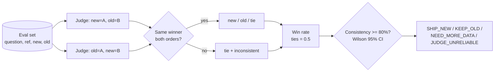

# Day 38 (AI): Pairwise LLM-as-judge with position-bias check

"Is the new prompt/model better than the old one?" Ask a judge to pick A or B,
**twice, with the answers swapped**. If the verdict flips with the order, the judge was
biased, so that pair is a tie. Then decide with a confidence interval, not a gut feel.



## Files
- `judges.py` - `HeuristicJudge` (offline: covers reference facts, penalises rambling, optional fake position bias), `OllamaJudge` (`llama3.2`, `OLLAMA_URL`, temperature 0), `parse_verdict` (chatty reply -> A/B/TIE).
- `arena.py` - `judge_pair` (swap test), `wilson` CI, `Report.decision()`.
- `demo.py` - 4 stock Q&A pairs.

## Run
```bash
python3 -m venv .venv && source .venv/bin/activate
pip install -r requirements.txt
pytest -q                            # 10 tests, offline
PYTHONPATH=src python src/demo.py
# real judge: pip install requests; ollama pull llama3.2; USE_OLLAMA=1 PYTHONPATH=src python src/demo.py
```

## Try this
Run the demo with `HeuristicJudge(position_bias=0.5)`. Watch consistency drop and the
decision change to `JUDGE_UNRELIABLE`. Then add 40 more rows and see the CI shrink.

