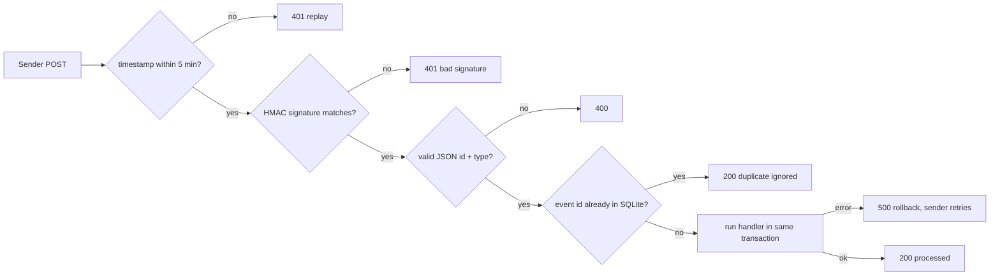

# Day 39 (Python): Secure, idempotent webhook receiver

Brokers, Stripe, GitHub and n8n all push events by webhook. This receiver accepts only real, fresh, first-time events and never double-processes a retry. Standard library only.



## Run
```bash
cd day-39-python-webhook-receiver
pip install -r requirements.txt
python3 demo.py
pytest -q
```

## Key ideas
- **Signature** = HMAC-SHA256 over `timestamp.body`, compared with `hmac.compare_digest` (constant time).
- **Replay window**: signed timestamp older than 5 min is rejected, so a stolen request can't be replayed later.
- **Idempotency**: event id is a SQLite PRIMARY KEY; insert + handler share one transaction.
- **Status codes**: 200 for duplicates (stop retrying), 500 on handler failure (please retry).
- **Key rotation**: pass several secrets; old and new both validate during the switch.
- Secrets come from env vars (e.g. `WEBHOOK_SECRET`); never commit them.
