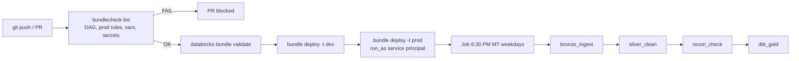

# Day 40 · DE · Ship the stock pipeline as a Databricks Asset Bundle

Days 1-37 built Bronze → Silver → recon → dbt Gold by hand. Today the whole job becomes **code in git**, checked in CI and deployed to dev or prod with one command.



## How it works
- `databricks.yml` = bundle name, variables, and **targets** (dev = `market_dev`, prod = `market_prod`).
- `resources/stock_job.yml` = the job: 4 tasks with `depends_on`, retries, timeouts, failure email, schedule.
- `bundlecheck` (pure Python) lints it: topological order, no cycles, prod uses `mode: production` + service principal, every `${var.x}` declared, no tokens in YAML, every task has a timeout.
- `recon_check` fails the run if Silver is short, so `dbt_gold` never builds on bad data.

## Run it locally
```bash
cd day-40-de-asset-bundle
pip install -r requirements.txt
PYTHONPATH=src python -m bundlecheck .   # shows order + 1 planted problem
pytest -q
```

## Run it on Databricks (your steps)
1. Install the CLI: `curl -fsSL https://raw.githubusercontent.com/databricks/setup-cli/main/install.sh | sh`
2. `databricks auth login --host <your-workspace-url>` (token stays in ~/.databrickscfg, never in git).
3. Fix the planted problem: declare `prod_sp_app_id` under `variables:`.
4. Put notebooks/dbt paths where yours live (Days 4, 7, 10, 37), then `databricks bundle validate -t dev`.
5. `databricks bundle deploy -t dev` → `databricks bundle run stock_pipeline -t dev`. Check **Workflows → Jobs → [dev you] stock-pipeline-dev**.
6. Optional: copy `.github/workflows/bundle-check.yml` to the repo root and add `DATABRICKS_HOST` / `DATABRICKS_TOKEN` repo secrets.

## Files
| File | Job |
|------|-----|
| `databricks.yml` | bundle, variables, dev/prod targets |
| `resources/stock_job.yml` | 4-task job, schedule, retries, alerts |
| `src/bundlecheck/core.py` | load + merge includes, Kahn order, lint rules |
| `src_notebooks/*.py` | thin Bronze / Silver / recon notebooks |
| `.github/workflows/bundle-check.yml` | CI: lint + `bundle validate` on PRs |
