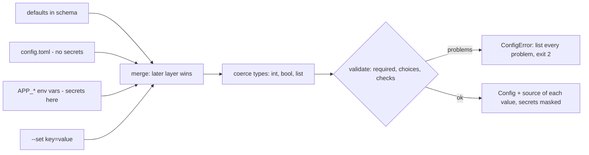

# Day 42 (Python): Layered, typed config loader

Every real pipeline needs settings for dev/test/prod. This loader merges 4 layers, converts each value to the right type, validates it, reports **all** errors at once, and never prints or stores secrets in files. Standard library only (`tomllib`).



## Run
```bash
cd day-42-python-layered-config
pip install -r requirements.txt
python3 demo.py --set log.level=DEBUG
APP_DB_PORT=99999 APP_LOG_LEVEL=LOUD python3 demo.py   # see all errors at once
pytest -q
```

## Key ideas
- **Precedence**: defaults < file < env < CLI. `cfg.explain()` shows which layer won for each key.
- **Env naming**: `db.port` -> `APP_DB_PORT`.
- **Types**: env/CLI values are strings; `coerce` turns "yes" into True, "AAPL,MSFT" into a list, and rejects `True` as an int.
- **Fail fast, fail once**: collect every problem, then raise one `ConfigError`.
- **Secrets**: rejected if found in the TOML file, masked (`****5678`) in output and error messages.
- **Strict mode** catches typos like `db.prot` in the file.

