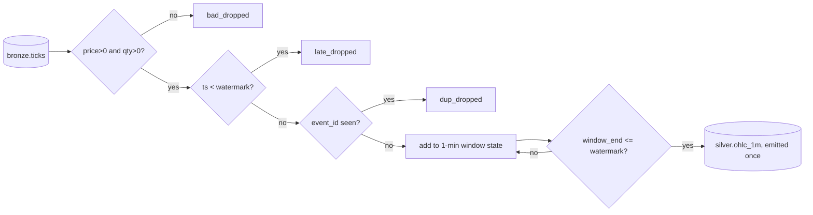

# Day 43 (DE): Streaming 1-minute OHLC bars with a watermark

Turns raw stock ticks (Bronze) into 1-minute candle bars (Silver), handling
late, duplicate and out-of-order events the way Spark Structured Streaming does.



watermark = newest event time seen − 30 s.

## Run locally
```bash
pip install -r requirements.txt
python3 demo.py
pytest -q
```

## Run on Databricks (you)
1. Make sure `market_dev.bronze.ticks` exists (event_id, ticker, ts, price, qty).
2. Create schema `market_dev.silver` and a volume `checkpoints` in it.
3. Paste `spark_job.py` into a notebook on DBR 14.3+ and run it.
4. `SELECT * FROM market_dev.silver.ohlc_1m ORDER BY window_start`.
5. Insert a tick 5 minutes old into Bronze, rerun: it is dropped as late (bar unchanged).

## Key ideas
- **Append mode** writes a bar once, only after the watermark passes the window end.
- **Watermark** bounds state: old windows and old dedupe ids are deleted.
- **open/close** use min_by/max_by on event time, so out-of-order ticks are fine.
